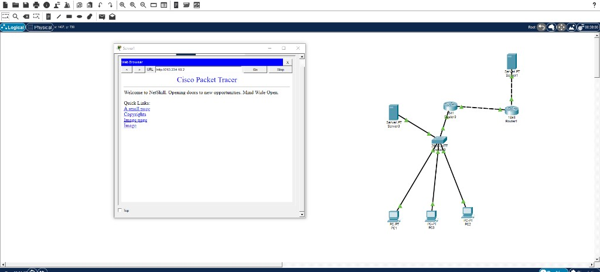
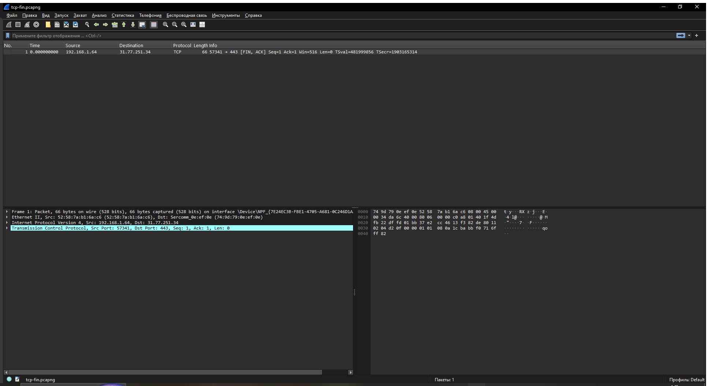
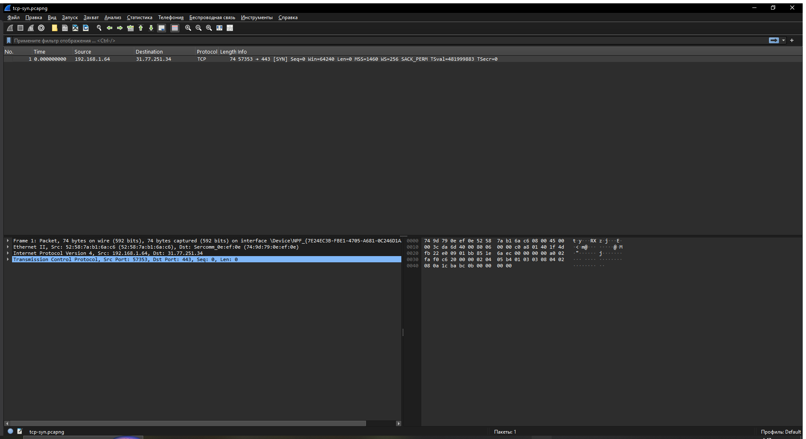
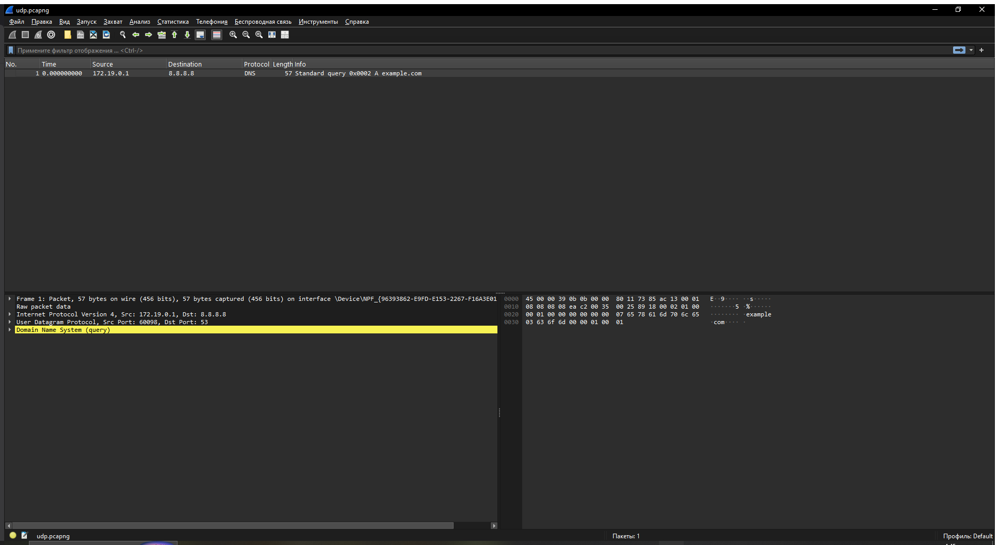

# Обозначения каждого скриншота
-  - показывает что цепь подключена и wed-браузер работает и отзываеться
-  - показывает какая сеть и протокол с работающим актом
-  - показывает какая сеть и протокол но уже без акта
-  - показывает домен сети и его состояние и вывод