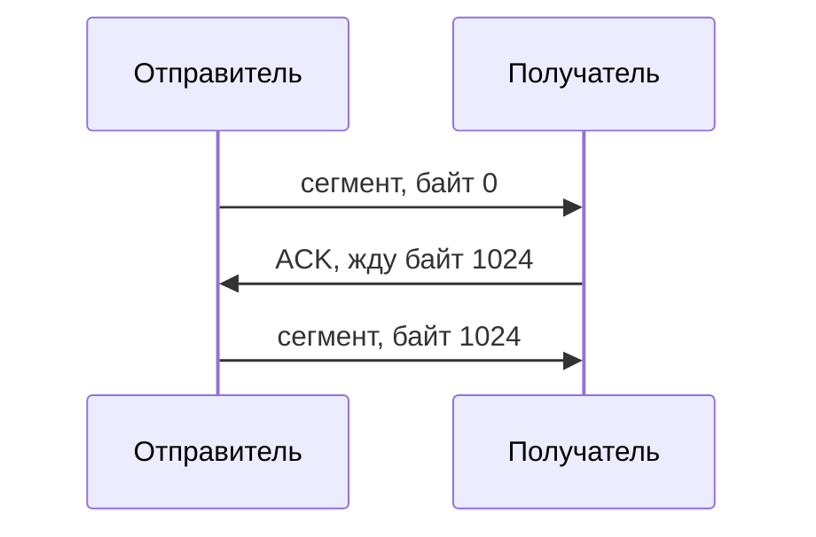
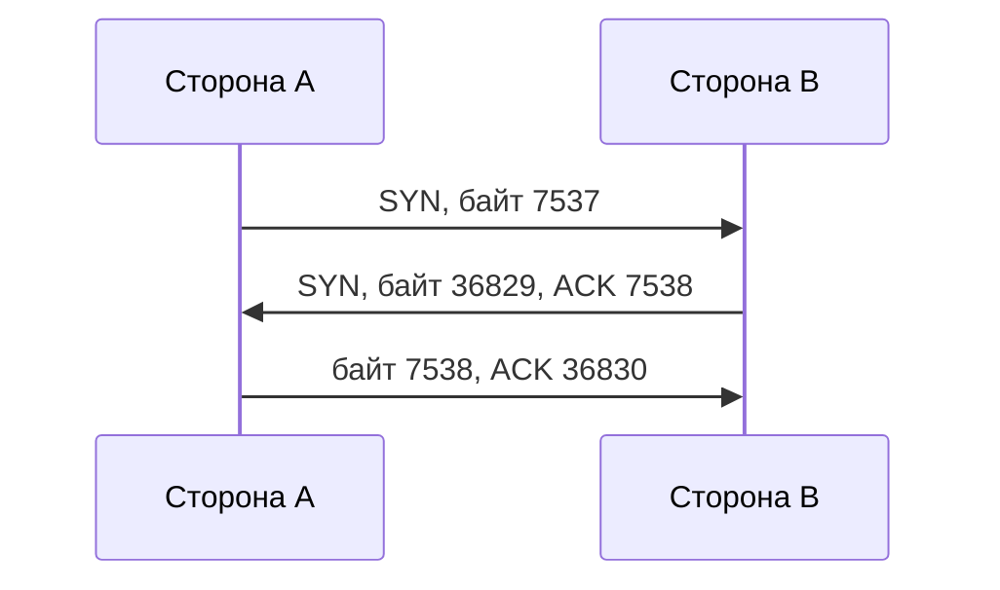

# TCP and UDP: reliability, ordering, and connection cost.

Краткий конспект по трём лекциям: место транспортного уровня в стеке, протокол UDP и протокол TCP. Текст пересказан так, чтобы по нему можно было отвечать, не листая презентации.

---

## 1. Где стоит транспортный уровень

В OSI это 4-й уровень. В стеке TCP/IP он лежит между приложениями и межсетевым уровнем.

| OSI | TCP/IP | Примеры |
| --- | --- | --- |
| Прикладной, представления, сеансовый | Приложений | HTTP, DNS, DHCP, FTP, SMTP, Telnet, SNMP, TFTP |
| Транспортный | Транспортный | TCP, UDP |
| Сетевой | Межсетевой | IPv4, IPv6, ICMP, IGMP |
| Канальный и физический | Сетевого доступа | Ethernet, PPP, Frame Relay, Wi-Fi, DSL; ARP и RARP |

Ниже сетевого уровня идёт инкапсуляция в кадры конкретной сети: Ethernet, Frame Relay, Token Ring, ATM, FDDI, X.25.

Транспортный уровень есть только на хостах. У маршрутизатора и прочего сетевого оборудования на схеме остаются физический, канальный и сетевой уровни: порты и сокеты им не нужны.

Его задача - довезти данные **между приложениями** двух компьютеров, а не просто между компьютерами. IP доставляет пакет на хост, а порт говорит, какому процессу его отдать.

Функции с лекции:

- сегментация данных приложения;
- сквозная передача сегментов от одного конечного узла к другому;
- адресация процессов портами;
- управление потоком размером окна;
- надёжность номерами и подтверждениями, если это умеет сам протокол.

Модуль данных транспортного уровня называют **TPDU**. У TCP это **сегмент**, у UDP - **дейтаграмма**.

Прикладной процесс обращается к транспорту через **интерфейс сокетов** (API).

Надёжность здесь может быть выше, чем у самой сети. Сеть (IP) старается доставить пакет, но ничего не обещает. Транспортный протокол может добавить подтверждения, повторную отправку и нумерацию. UDP этого не делает, TCP делает.

---

## 2. Порты и сокеты

Адрес транспортного уровня - **порт**, число от 1 до 65535. Вместе с IP его пишут так: `192.168.1.3:80`.

На одном хосте номера портов у приложений не повторяются. Пример со слайда: веб-сервер `192.168.1.100` слушает порт 80, а браузер на `192.168.1.2` открывает к нему два соединения со своих портов 50298 и 50302.

Диапазоны в лекциях чуть расходятся по границам. Рабочая таблица из второй презентации:

| Диапазон | Группа |
| --- | --- |
| 0-1023 | общеизвестные |
| 1024-49151 | зарегистрированные (в IANA) |
| 49152-65535 | динамические, их выдаёт операционная система |

В первой лекции границы сдвинуты на единицу: известные 1-1024, зарегистрированные 1025-49151, динамические с 49151. В третьей клиентские порты названы иначе: обычно **1024-5000**, и они уникальны только внутри компьютера.

Номера назначают двумя способами.

- **Централизованно.** Популярным службам IANA выдаёт зарезервированный порт из диапазона 1-1023. Такой номер один на весь Интернет, и занять его может только администратор (root).
- **Локально.** Клиенту порт выдаёт операционная система по запросу. Он должен быть уникален только на этом компьютере.

Частые порты со слайдов:

| Порт | Служба | Транспорт |
| --- | --- | --- |
| 20/21 | FTP | TCP |
| 23 | Telnet | TCP |
| 25 | SMTP | TCP |
| 53 | DNS | TCP и UDP |
| 67 и 68 | DHCP | UDP |
| 69 | TFTP | UDP |
| 80 | HTTP | TCP |
| 161 | SNMP | UDP (во второй лекции указаны оба) |

**Сокет** на этих лекциях - два разных, связанных слова.

1. Программный интерфейс, через который приложение пользуется TCP или UDP.
2. Пара, которая опознаёт конкретное TCP-соединение: IP и порт клиента плюс IP и порт сервера.

Посмотреть состояния соединений и слушающие порты: команда `netstat`. Проверить, открыт ли порт: `telnet адрес порт`.

---

## 3. UDP

**UDP (User Datagram Protocol)**, RFC 768 - дейтаграммный протокол без установки соединения. Сообщение UDP называют дейтаграммой, по аналогии с телеграммой.

Чего UDP не делает:

- не устанавливает соединение;
- не гарантирует доставку;
- не сохраняет порядок;
- не поднимает надёжность выше уровня IP;
- не управляет потоком и не восстанавливает порядок.

Это режим **best effort**. В IP такая дейтаграмма идёт с номером протокола **17**.

Главная работа UDP - **мультиплексирование и демультиплексирование**: сложить сообщения разных процессов в один поток IP и на приёме разложить их обратно по портам.

Порт UDP - это идентификатор приложения. Под него операционная система создаёт в памяти обменный буфер, входной и выходной. Если буфер переполнен, новые сообщения **отбрасываются**.

Одна операция вывода приложения - одна дейтаграмма. UDP не склеивает несколько записей в один пакет и не режет одну запись на сегменты так, как это делает TCP.

Заголовок UDP - 8 байт, четыре поля по 16 бит:

| Поле | Смысл |
| --- | --- |
| Порт отправителя | кто послал |
| Порт получателя | кому |
| Длина UDP | заголовок вместе с данными |
| Контрольная сумма | считается по заголовку и данным |

Длина минимум 8 байт (только заголовок) и максимум 65 515 байт: это предел данных IP-пакета.

Плюс UDP - скорость. Нет затрат на установку соединения. В современных сетях ошибки редки, а если пакет всё же пропал, повтор может сделать само приложение. Поэтому UDP берут для схемы «клиент - сервер» и коротких запросов-ответов.

Так устроен DNS (порт 53). Клиент спрашивает: «какой IP у www.cisco.com?», сервер отвечает `184.86.0.170`. Если ответ не пришёл, клиент просто повторяет тот же вопрос. Соединение для этого не нужно.

По той же причине UDP используют TFTP, SNMP и DHCP. В отличие от TCP, UDP пригоден для **широковещательной и групповой** рассылки.

Схема прохождения со слайда: приложение кладёт данные в свой порт (на рисунке TFTP - 69, DHCP - 67, обычное приложение - 1056), UDP отдаёт дейтаграмму протоколу IP, дальше её забирает драйвер Ethernet.

---

## 4. Что обещает TCP

**TCP (Transmission Control Protocol)**, RFC 793 - протокол управления передачей. Приложению он показывает не дейтаграммы, а **надёжный поток байт**.

Гарантии:

- данные будут доставлены;
- порядок байт сохранится.

Прикладной поток режется на сегменты. На слайде они начинаются с байтов 0, 1024, 2048, 3072. Сегменты идут по сети по отдельности, получатель собирает их и отдаёт приложению снова сплошным потоком.

Идентификатор сегмента - **номер его первого байта**, а не порядковый номер «сегмент №1, №2».

Передача состоит из трёх фаз: установка соединения, передача данных, разрыв. Накладных расходов больше, чем у UDP.

TCP не умеет широковещание и групповую рассылку. Для этого остаётся UDP.

Перед отправкой TCP может **подождать, пока заполнится буфер**, и только потом собрать сегмент. Если приложению нужно отправить данные сразу, оно ставит параметр **push**. Если какие-то байты надо отдать приложению-получателю вне очереди, отправитель помечает их как **urgent data**.

Службы, которые сидят на TCP: FTP, HTTP, SMTP, Telnet. DNS тоже умеет TCP, не только UDP.

---

## 5. Подтверждения: простой источника и скользящее окно

Надёжность TCP держится на двух вещах: получатель подтверждает принятые байты (**ACK**), отправитель заново шлёт то, что не подтверждено.

### Остановка и ожидание

Во второй лекции тот же приём назван **методом простоя источника**. Отправитель шлёт один сегмент и молчит, пока не придёт подтверждение.

Если подтверждение не пришло, тот же сегмент с байта 0 отправляют ещё раз. Потерянный сегмент так закрывается, но у метода четыре слабости:

- следующий сегмент нельзя слать, пока не подтверждён предыдущий, канал простаивает;
- порядок сам по себе не восстанавливается, если смотреть только на этот приём;
- сегмент может задвоиться;
- подтверждения и повтора мало, чтобы получить ровный поток байт.

### Скользящее окно

TCP поэтому работает окном. **Размер окна** - сколько байт можно отправить, не дожидаясь подтверждения.

В окне одновременно лежат уже подтверждённые байты, отправленные и ещё не подтверждённые, и те, которые пока слать нельзя. По мере прихода ACK окно сдвигается вперёд.

Подтверждение по умолчанию **кумулятивное**: ACK на байт N означает, что принят и этот байт, и все предыдущие. **Выборочное подтверждение (SACK)** подтверждает отдельные диапазоны принятых байт. Оно полезно при большом окне и передаётся параметром заголовка TCP, не основным полем.

---

## 6. Управление потоком

**Flow control** - чтобы быстрый отправитель не залил медленного получателя. Это свойство пары конечных узлов, не всей сети.

У получателя есть буфер. Приложение вычитывает его не мгновенно. В каждом ACK получатель сообщает, сколько байт ещё готов принять, - это и есть объявленное окно.

Пример со слайда:

- пришло подтверждение байта 2460, окно 10220;
- следующее подтверждение уже на 8300, окно сжалось до 4380;
- затем ACK 12680 и **размер окна 0**.

Ноль значит: буфер полон, слать данные нельзя. Отправитель время от времени посылает **Zero Window Probe** и спрашивает, не открылось ли окно снова.

---

## 7. Управление перегрузкой

**Congestion control** - другая задача. Здесь берегут не буфер получателя, а саму сеть: нельзя вывалить в неё столько сегментов, что маршрутизаторы начнут их выбрасывать.

Размер окна поэтому зависит ещё и от загрузки сети. Механизм называется **окном перегрузки**. Сигналы, по которым отправитель понимает, что сети плохо:

- потеря сегмента;
- задержка сегмента;
- явный сигнал от маршрутизатора.

Как эти сигналы ведут себя на лекции:

| Сигнал | Что происходит |
| --- | --- |
| Потеря сегмента | Окно растёт, пока перегрузка уже не случилась, и только потом уменьшается. Маршрутизатор, у которого кончился буфер, выбрасывает новые сегменты сразу у всех. Отправители дружно уменьшают окно и почти одновременно начинают снова. Это **глобальная синхронизация TCP** |
| Задержка сегмента | На загруженном канале это несправедливо: один уменьшает окно из-за задержки, остальные ждут настоящей потери. Сам по себе сигнал не очень надёжный. Зато менять нужно только отправителя |
| Оба сигнала вместе | Так делает, например, Compound TCP у Microsoft |
| Сигнал маршрутизатора | Надёжнее и перегрузка видна раньше, но менять приходится отправителя, получателя и маршрутизаторы: транспортный уровень начинает зависеть от сетевого |

Отдельно третья лекция называет **адаптивный выбор тайм-аута**: сколько ждать подтверждение, решают по измеренной задержке сети, а не по одной постоянной величине.

---

## 8. Соединение

Установка - **трёхкратное рукопожатие**. Числа со слайда:

7537 и 36829 - начальные номера байт, каждая сторона выбирает свой. ACK равен следующему ожидаемому байту: 7537 + 1 = 7538 и 36829 + 1 = 36830. После третьего шага соединение установлено.

Шесть управляющих бит, которые этим рулят:

| Бит | Смысл |
| --- | --- |
| URG | есть срочные данные, смотри указатель |
| ACK | поле номера подтверждения значимо |
| PSH | протолкнуть данные приложению, не копить |
| RST | оборвать соединение |
| SYN | синхронизировать начальные номера |
| FIN | отправитель больше не будет слать данные |

В заголовке на схеме есть ещё NS, CWR и ECE. Это уже дополнительные флаги, не из шестёрки, которой объясняется установка сеанса.

Разрыв на слайде: FIN, ACK, FIN, ACK. Каждая сторона отдельно сообщает, что данные у неё кончились, и подтверждает чужой FIN. **RST** рвёт соединение сразу, без этого обмена.

---

## 9. Заголовок TCP

Поля со слайда, сверху вниз:

| Поле | Зачем |
| --- | --- |
| Порт отправителя, порт получателя | те же порты, что у UDP |
| Порядковый номер | номер первого байта в этом сегменте |
| Номер подтверждения | номер следующего байта, который ждут |
| Длина заголовка | где кончается заголовок и начинаются данные |
| Флаги | URG, ACK, PSH, RST, SYN, FIN и дополнительные |
| Размер окна | сколько байт отправитель этого сегмента ещё готов принять |
| Контрольная сумма | по заголовку и данным |
| Указатель на срочные данные | где кончаются urgent data |
| Параметры | не обязательны |
| Данные | не обязательны |

Параметры, которые разобраны отдельно:

- **MSS** - максимальный размер сегмента;
- **масштаб окна** - чтобы окно можно было растянуть до 1 ГБ, это нужно быстрым каналам;
- **SACK** - выборочное подтверждение диапазонов;
- **метки времени**.

Во второй лекции окно определено чуть уже: «количество октетов, которое отправитель готов принять». Октет здесь - байт.

---

## Шпаргалка

| | UDP | TCP |
| --- | --- | --- |
| RFC | 768 | 793 |
| Соединение | нет | есть, три шага на установку |
| Единица данных | дейтаграмма, одна операция вывода | сегмент внутри потока байт |
| Доставка и порядок | не обещает | обещает |
| Управление потоком | нет | окно в ACK, вплоть до нулевого окна |
| Перегрузка сети | не учитывает | окно перегрузки |
| Широковещание и группы | да | нет |
| Номер протокола IP | 17 | на слайдах не назван |
| Где применяют | DNS, DHCP, TFTP, SNMP, короткие запросы | HTTP, FTP, SMTP, Telnet, длинные потоки |
| Заголовок | 8 байт: порты, длина, сумма | порты, номера байт, флаги, окно, сумма, параметры |

Коротко, что говорить устно:

- Транспорт соединяет процессы, адрес процесса - порт, соединение TCP опознаётся парой сокетов.
- UDP только разводит процессы по портам и почти ничего не обещает. Пропал ответ - приложение спросит ещё раз.
- TCP превращает ненадёжную сеть в поток байт: номера байт, кумулятивный ACK, повтор, скользящее окно.
- Окно получателя защищает медленный хост. Окно перегрузки защищает сеть. Ноль в окне получателя останавливает отправителя, пока не придёт Zero Window Probe с ненулевым окном.
